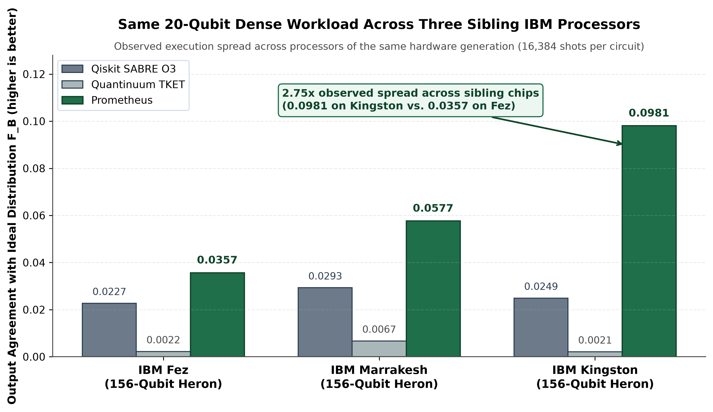

# Measuring How Quantum Processor Choice Affects Execution Quality

*Explore the portfolio: [Prometheus Quantum Overview](https://github.com/PrometheusDynamicsCanada/prometheus-quantum-overview)*

**Choosing which quantum processor runs a calculation can materially affect its result. This study measures those differences across processors and workloads.**

Cloud processors of the same hardware generation are often treated as interchangeable, even though sibling chips have different coupler-defect patterns. Comparing identical Qiskit SABRE, Quantinuum TKET, and Prometheus compilations across `ibm_fez`, `ibm_marrakesh`, and `ibm_kingston`, we separate **observed cross-processor spread** from **prospective pre-execution choice**:

- **Observed differences across sibling chips (`20-22` qubits):** Running the same 20-qubit dense workload produced **`0.0981`** output agreement on `ibm_kingston` versus **`0.0357`** on `ibm_fez` (**`2.75x` observed spread**), while at `21` and `22` qubits the winning compiler shifted across chips (Prometheus led two processors; SABRE led the third). Broadcast comparisons measure empirical cross-chip spread rather than blind pre-selection.
- **Prospective pre-execution selection (`9` qubits):** In a pre-committed validation test, choosing the processor before execution beat fixed single-chip assignment on **`6/6`** (`ibm_marrakesh`, `ibm_fez`) and **`5/6`** (`ibm_kingston`) configurations (larger `36`-workload queue selection is evaluated in [`prometheus-quantum-execution`](https://github.com/PrometheusDynamicsCanada/prometheus-quantum-execution)).

**[Detailed results](DETAILED_TECHNICAL_REPORT.md) · [Verify the evidence](#verify-the-evidence) · [Discuss a pilot](#discuss-a-pilot)**


*Opening summary (`Fez_Marrakesh_Kingston/` broadcast archive, `16,384` shots per circuit): Measured output-distribution agreement (`F_B`) on the same 20-qubit dense workload across `ibm_fez`, `ibm_marrakesh`, and `ibm_kingston`, illustrating the `2.75x` observed spread across sibling 156-qubit processors.*

---

## 1. Executive Summary & Principal Multi-QPU Broadcast Comparison (20Q-22Q)


> [!NOTE]
> **Metric & Direction Conventions:**
> - **Classical Computational-Basis Distribution Overlap (F_B, ↑ higher is better):** Throughout this repository (`fidelity` in JSON ledgers and `"State Fidelity"` in Studio UI screenshots), values report F_B(P_ideal, P_meas) = Σ_x √(P_ideal(x) · P_meas(x)) = √F_H (where F_H = F_B² is Squared Hellinger Fidelity). Both evaluate computational-basis measurement distributions from shot counts and are distinct from 4ⁿ state tomography.
> - **Total Variation Distance (TVD, ↓ lower is better):** 0.5 · Σ_x |P_ideal(x) - P_meas(x)|.
> - **Linear Cross-Entropy Benchmarking (XEB, ↑ higher is better):** 2ⁿ · Σ_x P_ideal(x) · P_meas(x) - 1.
> - **Heavy-Output Probability (HOP, ↑ higher is better):** Measured probability mass on bitstrings exceeding the median of P_ideal(x).

### Table 1: 20Q-22Q Multi-QPU Broadcast Summary (9 Jobs, 27 Circuits, 442,368 Shots)

| Workload Width | Target Processor | SABRE O3 Fidelity F_B (↑) | TKET Fidelity F_B (↑) | Prometheus Fidelity F_B (↑) | Best Strategy on Target QPU | Cross-QPU Arbitrated Winner for Width |
| :---: | :--- | ---: | ---: | ---: | :--- | :--- |
| **20Q Dense (K_20)** | `ibm_fez` | 0.0227 | 0.0022 | **0.0357** | Prometheus (+57.4% vs. SABRE) | `ibm_kingston` (**0.0981** Prometheus, 2.75x vs. Fez) |
| **20Q Dense (K_20)** | `ibm_kingston` | 0.0249 | 0.0021 | **0.0981** | **Prometheus (+293.8% vs. SABRE)** | **`ibm_kingston` (0.0981 Prometheus, 2.75x vs. Fez)** |
| **20Q Dense (K_20)** | `ibm_marrakesh` | 0.0293 | 0.0067 | **0.0577** | Prometheus (+97.3% vs. SABRE) | `ibm_kingston` (**0.0981** Prometheus, 1.70x vs. Marrakesh) |
| **21Q Dense (K_21)** | `ibm_fez` | 0.0133 | 0.0012 | **0.0345** | Prometheus (+159.4% vs. SABRE) | `ibm_kingston` (**0.1059** SABRE) / `ibm_marrakesh` (**0.0904** Prom) |
| **21Q Dense (K_21)** | `ibm_kingston` | **0.1059** | 0.0020 | 0.0813 | **SABRE O3 (+30.3% vs. Prom)** | **`ibm_kingston` (0.1059 SABRE / 0.0904 Prom on Marrakesh)** |
| **21Q Dense (K_21)** | `ibm_marrakesh` | 0.0641 | 0.0136 | **0.0904** | Prometheus (+41.0% vs. SABRE) | `ibm_kingston` (**0.1059** SABRE) / `ibm_marrakesh` (**0.0904** Prom) |
| **22Q Dense (K_22)** | `ibm_fez` | 0.0002 | 0.0005 | **0.0275** | Prometheus (55.0x vs. TKET) | `ibm_marrakesh` (**0.1036** SABRE) / `ibm_kingston` (**0.0944** Prom) |
| **22Q Dense (K_22)** | `ibm_kingston` | 0.0636 | 0.0003 | **0.0944** | Prometheus (+48.4% vs. SABRE) | `ibm_marrakesh` (**0.1036** SABRE) / `ibm_kingston` (**0.0944** Prom) |
| **22Q Dense (K_22)** | `ibm_marrakesh` | **0.1036** | 0.0021 | 0.0815 | **SABRE O3 (+27.1% vs. Prom)** | **`ibm_marrakesh` (0.1036 SABRE / 0.0944 Prom on Kingston)** |

<details>
<summary><strong>Expand Archived Studio UI Telemetry Capture (Job dah7jq7i3e6s738nf8h0 on ibm_kingston)</strong></summary>


*Archived Studio UI capture for 20-Qubit Dense All-to-All (`K_20`) on `ibm_kingston` (`16,384` shots/compiler; `F_B`: SABRE O3 = `0.0249`, TKET = `0.0021`, Prometheus = `0.0981`; Note: Studio UI labels `F_B` as `"State Fidelity"`).*

</details>

---

## Verify the Evidence

**Verification Kind:** Direct **raw IBM Quantum Job ZIP payload reconstruction** (`33` archived QPU job bundles in `Fez/`, `Kingston/`, `Marrakesh/`, and `Fez_Marrakesh_Kingston/`, plus the shared `144`-execution validation suite; both cross-mapped and counted once in [`prometheus-quantum-overview`](https://github.com/PrometheusDynamicsCanada/prometheus-quantum-overview)):

```bash
python Fez_Marrakesh_Kingston/3_verify_and_view.py --dir Fez_Marrakesh_Kingston
```

- **Key files:** [`DETAILED_TECHNICAL_REPORT.md`](DETAILED_TECHNICAL_REPORT.md) · [`EVIDENCE_INDEX.md`](EVIDENCE_INDEX.md) · [`ALL_RESULTS.csv`](ALL_RESULTS.csv) · [`REPOSITORY_SHA256SUMS.txt`](REPOSITORY_SHA256SUMS.txt)

---

## Discuss a Pilot

**Bring a representative workload and an acceptance criterion. We can compare Prometheus with your existing execution approach and measure quality, acceptance rate and charged hardware resources.**

- **Contact:** [william@prometheusdynamics.ca](mailto:william@prometheusdynamics.ca) | [prometheusdynamics.ca](https://prometheusdynamics.ca)
